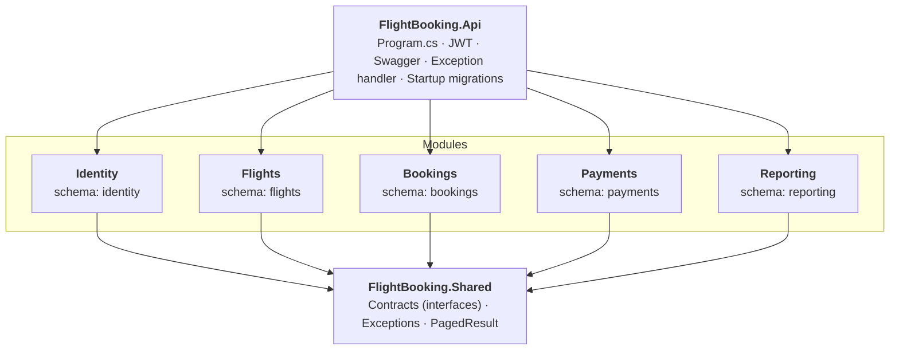
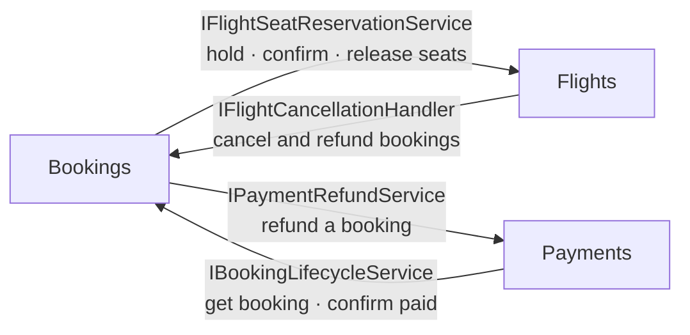
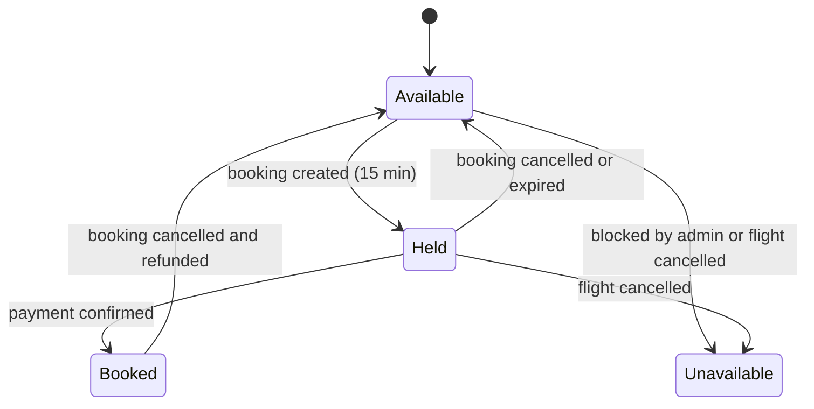
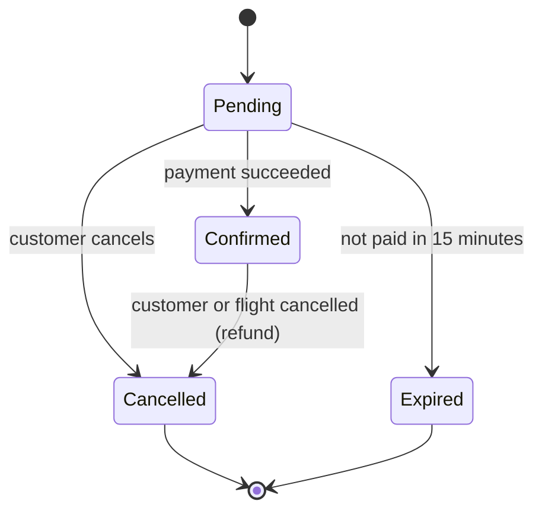
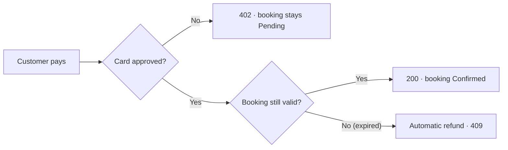

<div align="center">

# ✈️ Flight Booking API

**A modular monolith for searching flights, holding seats, paying, and managing bookings, built with .NET 8.**


</div>

---

## Table of Contents

- [Overview](#overview)
- [Highlights](#highlights)
- [Architecture](#architecture)
- [Design Decisions](#design-decisions)
- [Domain Model](#domain-model)
- [API Reference](#api-reference)
- [Getting Started](#getting-started)
- [Try It Out](#try-it-out)
- [Error Handling](#error-handling)
- [Tech Stack](#tech-stack)
- [Project Structure](#project-structure)
- [Roadmap](#roadmap)

---

## Overview

Flight Booking API is the backend of an airline booking platform. **Customers** search flights, pick seats, pay, and cancel. **Admins** manage airports, aircraft, flights, and pricing, and read business reports.

The system is built as a **modular monolith**: one deployable application made of five independent modules (Identity, Flights, Bookings, Payments, Reporting). Each module owns its data and exposes only a small contract to the others, so the codebase stays organized like microservices without the operational cost.

It handles the problems real booking systems face:

- Two customers trying to book the same seat at the same moment.
- A customer paying twice by double-clicking.
- A booking that expires while its payment is being processed.
- A flight that is cancelled after customers have already paid.

> Payments use a built-in mock gateway, so the project focuses on booking logic and architecture rather than a payment-provider integration.

---

## Highlights

| | |
|---|---|
| 🧩 **Modular Monolith** | 5 independent modules, each with its own `DbContext`, SQL schema, and migrations. No project references between modules. |
| 🔐 **Authentication** | JWT access tokens, refresh tokens with rotation and revocation, role-based authorization (`Admin`, `Customer`). |
| 🪑 **Seat holds** | Seats are held for 15 minutes. A background service releases them when an unpaid booking expires. |
| ⚔️ **Concurrency safe** | Optimistic concurrency (`RowVersion`) plus a filtered unique index. Two customers can never own the same seat. |
| 💳 **Idempotent payments** | The same `Idempotency-Key` returns the same result. A booking can never have two successful payments. |
| ↩️ **Refunds** | Automatic refunds on booking cancellation, on flight cancellation, and when a payment succeeds after the booking expired. |
| 📊 **Reporting** | Revenue, bookings by status, top routes, flight occupancy. Cached for 5 minutes. |
| 🧼 **Clean API** | Immutable record DTOs, a global exception handler returning `ProblemDetails`, enums serialized as strings, Swagger with JWT support. |

---

## Architecture

The application is **one deployable unit** split into five modules. Each module is its own class library and owns its data. The `Api` project is the only place that knows about all of them.



### Modules

| Module | Responsibility |
|---|---|
| **Identity** | Registration, login, JWT, refresh token rotation and revocation, roles, seeding. |
| **Flights** | Airports, aircraft and their seat maps, flights, per-flight seats and pricing, search, flight status transitions and cancellation. |
| **Bookings** | Creating bookings, holding seats, confirmation, cancellation, automatic expiry, passenger types. |
| **Payments** | Mock gateway, idempotent charges, refunds, payment history. |
| **Reporting** | Read-only reports over the other modules' tables. |

### How modules talk to each other

Modules never reference each other. They depend on **contracts** defined in `FlightBooking.Shared`, and the implementations are injected at runtime.



There are **no foreign keys across schemas**. A booking stores the `FlightId` and a snapshot of the flight (number, airports, departure) so it still reads correctly after the flight changes.

### One database, five schemas

All modules use the same SQL Server database, but each has its own `DbContext`, its own schema, and its own `__EFMigrationsHistory` table inside that schema. Without this, five contexts would write to the same history table and break each other's migrations. With it, every module evolves independently and could be extracted into its own database later.

---

## Design Decisions

### 1. Seat double-booking is prevented twice

- `FlightSeat` and `Booking` carry a `RowVersion` token. If two requests update the same seat, one fails with `DbUpdateConcurrencyException`, translated to **`409 Conflict`**.
- `BookingSeat` has a **unique index on `FlightSeatId` filtered by `IsActive = 1`**. A seat can only be active in one booking, but after a cancellation it can be booked again.

### 2. Payments are idempotent

The `Idempotency-Key` header is required. The result of the first request is stored and returned for any repeat of the same key by the same user.

- Same key, same request: the stored response is returned and nothing is charged again.
- Same key, different request: `409 Conflict`.
- A **filtered unique index** (`Status = 'Succeeded'`) guarantees at the database level that a booking has at most one successful payment.

### 3. Seat-first confirmation

When a payment succeeds, the seats are confirmed in the Flights module **before** the booking is marked `Confirmed`. If the booking expired or was cancelled in the meantime, the confirmation fails, the payment is **refunded automatically**, and the API returns `409`.

### 4. Automatic expiry

A `BackgroundService` runs every 30 seconds, finds `Pending` bookings past their expiry time, marks them `Expired`, and releases their seats.

### 5. Flight cancellation cascades

Cancelling a flight cancels all its `Pending` and `Confirmed` bookings and refunds the paid ones. Each booking is handled on its own, so one failed refund does not block the rest. If any fail, the request returns `409`, and **calling it again is safe**: it only processes what is left.

### 6. Passenger types come from the date of birth

At departure: under 2 is `Infant`, under 12 is `Child`, otherwise `Adult`. A booking needs at least one adult, and a booking can have 1 to 9 passengers.

### 7. Time zones

All timestamps are stored in UTC. Flight search takes a date in the **departure airport's time zone** (IANA ids such as `Africa/Cairo`), including the day boundary around daylight saving changes.

### 8. Reporting without coupling to services

The Reporting module maps **keyless read models** onto the other modules' tables (excluded from its migrations) and aggregates them in SQL. Results are cached in its own table for 5 minutes.

---

## Domain Model

### Seat lifecycle



### Booking lifecycle



### Flight status

`Scheduled → Boarding → Departed → Arrived`, and `Scheduled` or `Boarding` can move to `Cancelled`. `Arrived` and `Cancelled` are final. Transitions are validated in one place.

### Payment flow



### Data model (per schema)

| Schema | Tables |
|---|---|
| `identity` | ASP.NET Identity tables, `RefreshTokens` |
| `flights` | `Airports`, `Aircrafts`, `AircraftSeats`, `Flights`, `FlightSeats` |
| `bookings` | `Bookings`, `BookingPassengers`, `BookingSeats` |
| `payments` | `Payments`, `Refunds`, `IdempotencyRecords` |
| `reporting` | `GeneratedReports` |

---

## API Reference

All routes start with `/api`. **Auth** column: *public* needs no token, *user* any signed-in user, *Admin* the `Admin` role.

### Auth

| Method | Route | Auth | Description |
|---|---|---|---|
| POST | `/auth/register` | public | Register a customer |
| POST | `/auth/login` | public | Get an access token and a refresh token |
| POST | `/auth/refresh-token` | public | Exchange a refresh token for a new pair (rotation) |
| POST | `/auth/revoke-token` | user | Revoke a refresh token |
| GET | `/auth/me` | user | Current user and roles |

### Airports

| Method | Route | Auth | Description |
|---|---|---|---|
| GET | `/airports` | public | List with search and paging (ordered by country, then city) |
| GET | `/airports/{id}` | public | Get by id |
| GET | `/airports/by-code/{iataCode}` | public | Get by IATA code |
| POST · PUT · DELETE | `/airports`, `/airports/{id}` | Admin | Create, update, delete |

### Aircraft (Admin)

| Method | Route | Description |
|---|---|---|
| GET | `/aircrafts`, `/aircrafts/{id}` | List and get |
| POST · PUT | `/aircrafts`, `/aircrafts/{id}` | Create and update |
| PATCH | `/aircrafts/{id}/activate`, `/deactivate` | Activate or deactivate |
| GET | `/aircrafts/{aircraftId}/seats` | Seat map |
| POST | `/aircrafts/{aircraftId}/seats`, `/seats/bulk` | Add one seat or many |
| PUT · DELETE | `/aircrafts/{aircraftId}/seats/{seatId}` | Update or remove a seat |

### Flights

| Method | Route | Auth | Description |
|---|---|---|---|
| GET | `/flights/search` | public | Search by `origin`, `destination`, `date`, `passengers`, optional `cabinClass` |
| GET | `/flights/{id}` | public | Flight details |
| GET | `/flights/{id}/seats` | public | All seats |
| GET | `/flights/{id}/seats/available` | public | Available seats only |
| GET | `/flights` | Admin | Admin list (number, status, date range) |
| POST · PUT · DELETE | `/flights`, `/flights/{id}` | Admin | Create, update (Scheduled only), delete |
| PATCH | `/flights/{id}/status` | Admin | Change status (validated transitions) |
| POST | `/flights/{id}/cancel` | Admin | Cancel flight, its bookings, and refund |
| POST | `/flights/{id}/seats/generate` | Admin | Generate seats with a price per cabin class |
| PUT | `/flights/{id}/seats/pricing` | Admin | Update prices |
| PATCH | `/flights/{id}/seats/{seatId}/block` | Admin | Block a seat |

### Bookings

| Method | Route | Auth | Description |
|---|---|---|---|
| POST | `/bookings` | user | Create a booking (seats are held 15 minutes) |
| GET | `/bookings/my` | user | My bookings (filter by status, paged) |
| GET | `/bookings/{id}` | user | Booking details (owner or Admin) |
| POST | `/bookings/{id}/cancel` | user | Cancel (refund if paid). Owner or Admin. A confirmed booking cannot be cancelled after departure (`422`) |
| GET | `/bookings` | Admin | All bookings (status, user, flight) |

### Payments

| Method | Route | Auth | Description |
|---|---|---|---|
| POST | `/payments` | user | Pay for a booking. Requires the `Idempotency-Key` header |
| GET | `/payments/{id}` | user | Payment details (owner or Admin) |
| GET | `/payments/booking/{bookingId}` | user | Payments of a booking (owner or Admin) |

### Reports (Admin)

| Method | Route | Description |
|---|---|---|
| GET | `/reports/revenue` | Revenue, refunds, and net per day (`from`, `to`, `currency`) |
| GET | `/reports/bookings-by-status` | Count and amount per status |
| GET | `/reports/top-routes` | Top routes by bookings and revenue (`top`) |
| GET | `/reports/flight-occupancy` | Seats booked, held, available, and occupancy % per flight |

### Mock payment tokens

| `cardToken` | Result |
|---|---|
| `tok_success` | Payment succeeds, booking becomes `Confirmed` (`200`) |
| `tok_declined` | The card is declined (`402`), booking stays `Pending` |
| `tok_insufficient_funds` | Insufficient funds (`402`), booking stays `Pending` |

---

## Getting Started

**Requirements:** .NET 8 SDK, Docker (for SQL Server), and the EF Core CLI tool.

1. **Start SQL Server** in a Docker container and expose port 1433.
2. **Configure the app** in `appsettings.Development.json`: the SQL Server connection string (`ConnectionStrings:DefaultConnection`, shared by all modules), a JWT secret of at least 32 characters (`Jwt:Secret`), and the admin account to seed (`Seed:AdminEmail`, `Seed:AdminPassword`). Do not commit real secrets.
3. **Create the initial migration for each of the five modules** with the EF Core CLI. Each module has its own `DbContext` and its own migrations.
4. **Run the Api project** in the `Development` environment. It applies all migrations, creates the roles and the admin account, and seeds demo data automatically.
5. **Open Swagger** at `http://localhost:5080/swagger`.

### Demo data

| What | Details |
|---|---|
| Customers | `ahmed.ali@example.com`, `sara.hassan@example.com`, `omar.khaled@example.com`, `mona.adel@example.com` (password `Customer@123`) |
| Airports | CAI, DXB, JED, RUH, IST, LHR |
| Aircraft | Boeing 737-800, Airbus A320, and one inactive Airbus A330, with Economy, Premium Economy, Business, and First seats |
| Flights | 11 flights covering every status: `Scheduled`, `Boarding`, `Departed`, `Arrived`, `Cancelled` |
| Bookings | 10 bookings: `Confirmed`, `Pending`, `Expired`, `Cancelled`, with adult, child, and infant passengers |
| Payments | Succeeded, failed, and refunded payments with matching refunds and idempotency records |

The demo data is created only on an empty database.

---

## Try It Out

A complete flow from Swagger:

1. **Sign in** as a demo customer, then click **Authorize** and paste the token.
2. **Search flights** by origin, destination, date (in the departure airport's time zone), and number of passengers.
3. **Pick seats** from the flight's available seats.
4. **Create a booking** with each passenger's name, date of birth, and chosen seat. The seats are now held for 15 minutes.
5. **Pay** with the `Idempotency-Key` header and one of the mock tokens. Repeating the request with the same key returns the same result and charges nothing twice.
6. **Cancel** the booking. The payment is refunded and the seats become available again.
7. **As Admin**, cancel a flight to see its bookings cancelled and refunded, or open the reports.

---

## Error Handling

One global exception handler converts exceptions into RFC 7807 `ProblemDetails`.

| Situation | Status |
|---|---|
| Validation error (DataAnnotations) | `400` |
| Missing `Idempotency-Key` header | `400` |
| Not signed in / wrong role | `401` / `403` |
| Resource not found | `404` |
| Conflict: duplicate value, seat already taken, key reused with a different request, concurrent update | `409` |
| Business rule violated (invalid status transition, flight not open for booking, no adult passenger, ...) | `422` |
| Payment declined or insufficient funds | `402` |
| Anything unexpected | `500` (generic message, no internal details) |

---

## Tech Stack

| | |
|---|---|
| Runtime | .NET 8, ASP.NET Core Web API |
| Data | Entity Framework Core 8, SQL Server (Docker), LINQ |
| Auth | ASP.NET Core Identity (`AddIdentityCore`), JWT Bearer, refresh tokens |
| Docs | Swagger (Swashbuckle) with a JWT security scheme |
| Background work | `IHostedService` / `BackgroundService` |
| Style | Record DTOs with `init` properties, DataAnnotations validation, enums stored and serialized as strings |

---

## Project Structure

```
src/
├── FlightBooking.Api/                 Composition root
│   ├── ExceptionHandling/             Global exception handler
│   ├── Extensions/                    JWT and Swagger setup
│   └── Program.cs
├── FlightBooking.Shared/              Contracts, exceptions, PagedResult
│   ├── Common/
│   ├── Contracts/                     Flights · Bookings · Payments
│   └── Exceptions/
└── FlightBooking.Modules.<Name>/      Identity · Flights · Bookings · Payments · Reporting
    ├── Domain/                        Entities, enums
    ├── Application/                   DTOs, service interfaces
    ├── Infrastructure/                DbContext, configurations, services
    ├── Presentation/Controllers/
    └── <Name>ModuleExtensions.cs      AddXModule(connectionString)
```

Each module exposes a single extension method, `AddXModule(connectionString)`, that registers its `DbContext` and services. The Api adds each module's controllers with `AddApplicationPart`.

---

## Roadmap

Automated tests, Docker Compose for the API and database, rate limiting, health checks, structured logging, and an outbox for cross-module events.

---

<div align="center">

**Built by <your name>** · [LinkedIn](<your-linkedin-url>) · [GitHub](<your-github-url>)

Feedback and suggestions are welcome.

</div>
